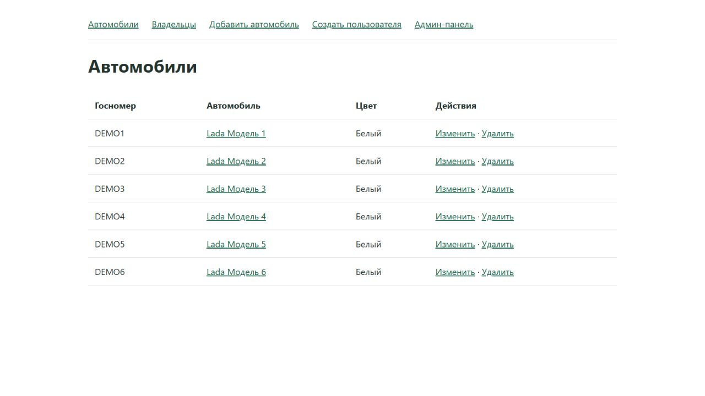

# Практические работы 2.1–2.3

**Студент:** Govorov Pavel · **Группа:** K3340

Исходный код: `students/k3340/practical_works/Govorov_Pavel/simple_django_web_project/`.

Проект `django_project_govorov`, приложение `project_first_app`.

## Практика 2.1. Модели и Django Admin

| Модель | Поля и связи |
|---|---|
| `Owner` | Имя, фамилия, дата рождения, паспорт, адрес, национальность |
| `Car` | Госномер, марка, модель, цвет |
| `Ownership` | Владелец, автомобиль, даты владения |
| `DrivingLicense` | Владелец, номер, тип, дата выдачи |

Модели зарегистрированы в Django Admin. Созданы и применены миграции. Страница `/owner/<id>` показывает данные владельца.

## Практика 2.2. FBV и CBV

| Действие | Представление |
|---|---|
| Список и создание владельцев | FBV: `owner_list`, `owner_create` |
| Список автомобилей | CBV: `CarList` |
| Страница автомобиля | CBV: `CarDetail` |
| Создание автомобиля | CBV: `CarCreate` |
| Изменение автомобиля | CBV: `CarUpdate` |
| Удаление автомобиля | CBV: `CarDelete` |

## Практика 2.3. Пользователь

`Owner` расширяет `AbstractUser`. Добавлены дата рождения, номер паспорта, адрес и национальность. Поля доступны в форме создания пользователя и Django Admin.

## Запуск и проверка

Установите зависимости, настройте `.env`, затем выполните `migrate`, `createsuperuser` и `runserver 8001`. Проверены `manage.py check`, создание владельца и операции с автомобилями.

Требования: [2.1](https://rendex85.github.io/ITMO_ICT_WebDevelopment_Docs/lab2/practice1/), [2.2](https://rendex85.github.io/ITMO_ICT_WebDevelopment_Docs/lab2/practice2/), [2.3](https://rendex85.github.io/ITMO_ICT_WebDevelopment_Docs/lab2/practice3/).
