# Лабораторная работа №2. Список отелей

**Студент:** Govorov Pavel · **Группа:** K3340 · **Вариант:** 1

Исходный код: `students/k3340/laboratory_works/Govorov_Pavel/laboratory_work_2/`.

## Реализовано

- Регистрация, вход и выход пользователей.
- Каталог отелей и номеров с поиском, фильтрами и пагинацией.
- Создание, изменение и удаление собственных бронирований.
- Отзывы с автором, периодом проживания, текстом и оценкой 1–10.
- Заселение и выселение через Django Admin.
- Таблица постояльцев за последний месяц для администратора.
- Адаптивная CSS-вёрстка и разграничение прав в интерфейсе.

## Технологии

Python 3.14, Django 5.2.18, Jinja2 3.1.6, PostgreSQL 16, psycopg 3.

## Модели

| Модель | Поля | Связи |
|---|---|---|
| User | Логин, пароль, имя, фамилия, права | Брони и отзывы пользователя |
| Hotel | Название, владелец, адрес, описание | Отель содержит номера |
| Room | Номер, тип, цена, вместимость, удобства | Номер относится к отелю |
| Booking | Даты, число гостей, статус, фактическое заселение и выселение | Пользователь и номер |
| Review | Период проживания, текст, оценка 1–10 | Пользователь и номер |

Номер уникален внутри отеля. Проверяются даты, вместимость, пересечение бронирований и диапазон оценок.

## Интерфейс

Поиск работает без учёта регистра по названию отеля, адресу и удобствам. Фильтры: тип номера, вместимость и цена. На странице номера показаны данные отеля, цена, вместимость, удобства и отзывы.

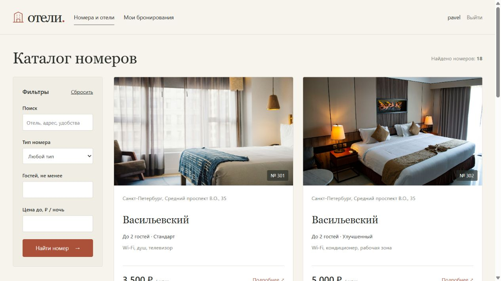

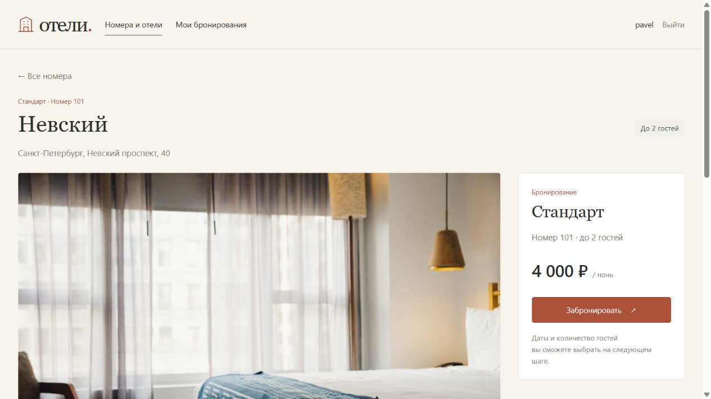

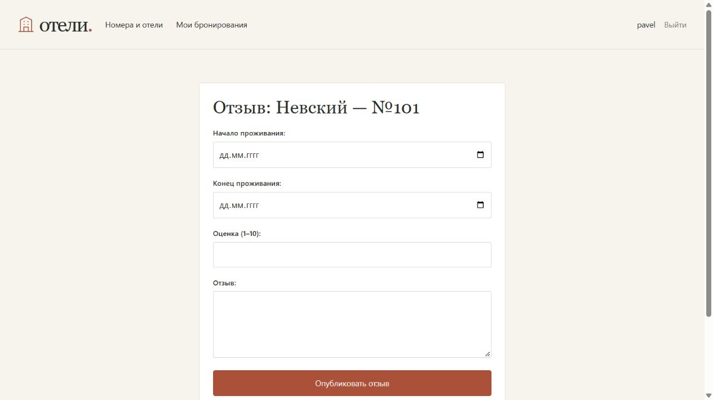

Пользователь может управлять только собственными бронированиями. Удаление подтверждается отдельной страницей и выполняется методом POST.

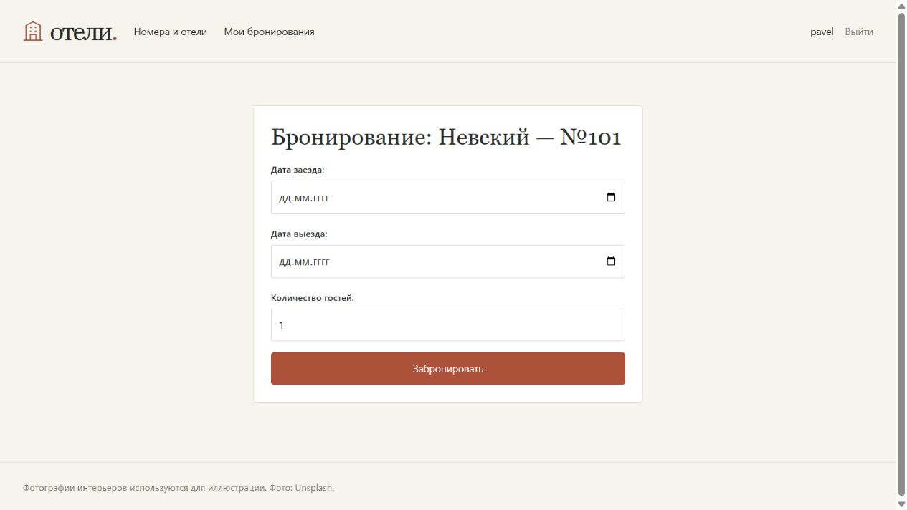

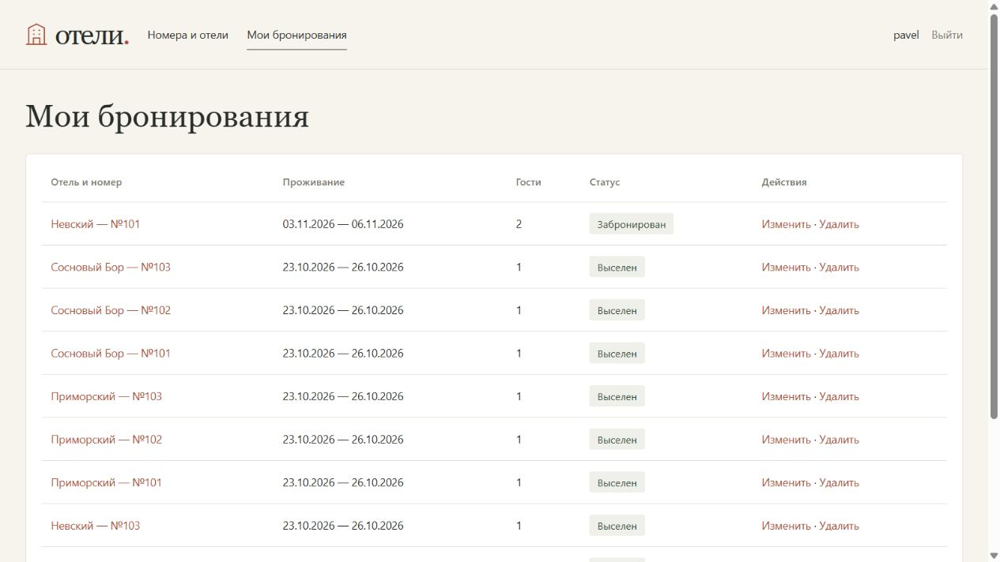

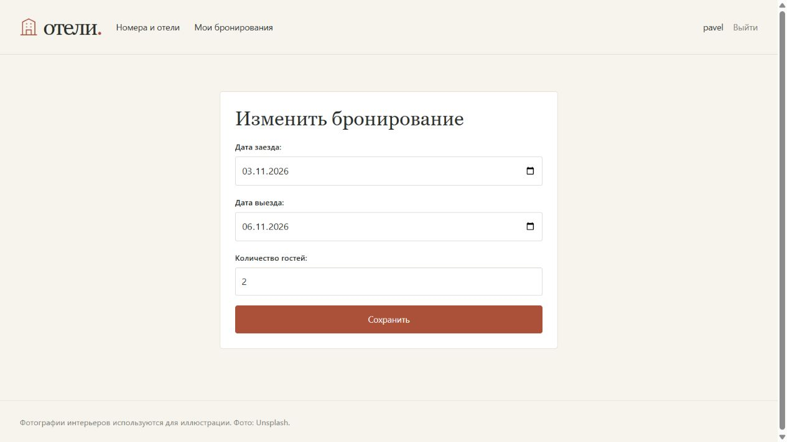

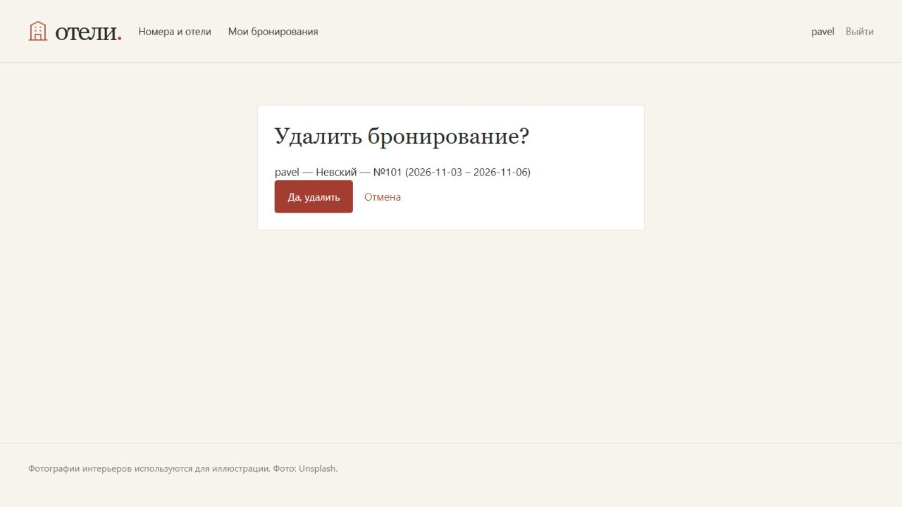

Администратор управляет заселением и выселением через Django Admin. В таблице постояльцев отображаются реальные проживания за последний месяц; доступен фильтр по отелю.

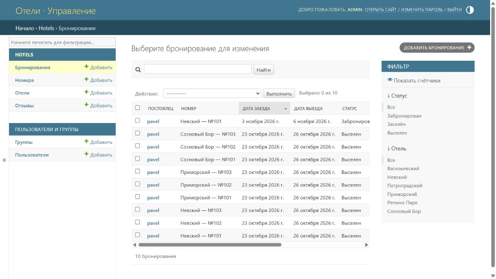

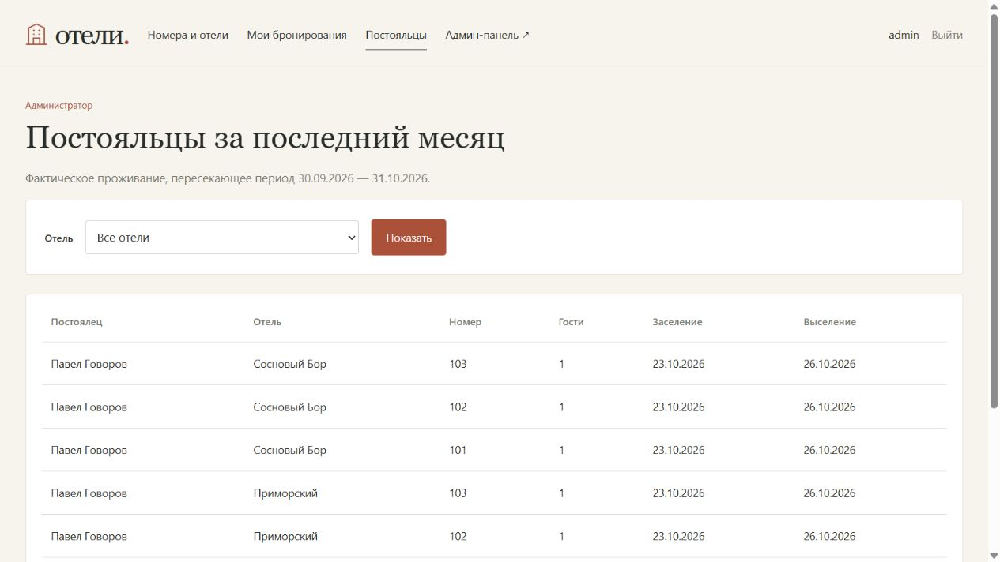

Регистрация и вход доступны через формы сайта. Пользователь может оставить отзыв после входа.

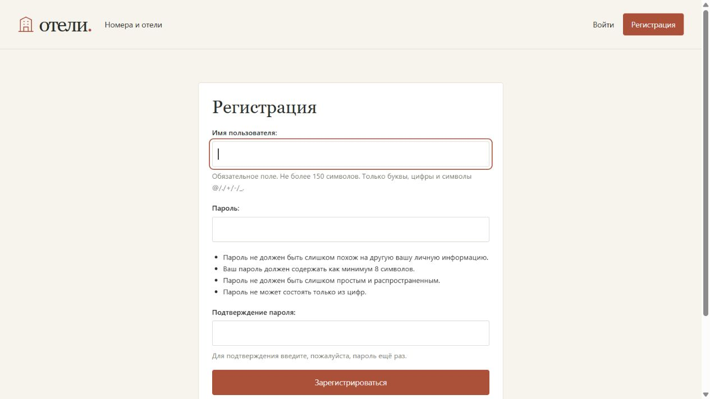

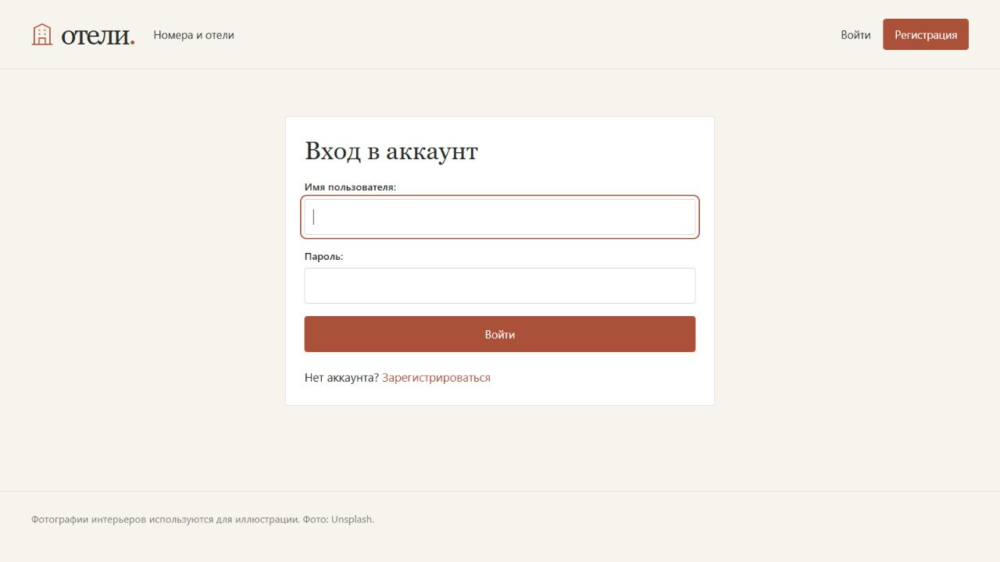

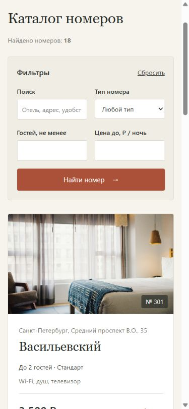

## Маршруты

| URL | Методы | Назначение |
|---|---|---|
| `/` | GET | Каталог, поиск, фильтры, пагинация |
| `/rooms/<id>/` | GET | Номер и отзывы |
| `/accounts/signup/` | GET, POST | Регистрация |
| `/accounts/login/` | GET, POST | Вход |
| `/accounts/logout/` | POST | Выход |
| `/rooms/<id>/book/` | GET, POST | Создание бронирования |
| `/bookings/` | GET | Свои бронирования |
| `/bookings/<id>/edit/` | GET, POST | Изменение своей брони |
| `/bookings/<id>/delete/` | GET, POST | Удаление своей брони |
| `/rooms/<id>/review/` | GET, POST | Добавление отзыва |
| `/staff/guests/` | GET | Таблица постояльцев для администратора |
| `/admin/` | GET, POST | Django Admin |

## Проверка

Выполнены миграции и `manage.py check`. Проверены поиск, фильтры, формы, бронирования, права доступа, отзывы и таблица постояльцев.

Подробные команды запуска приведены в README проекта.
